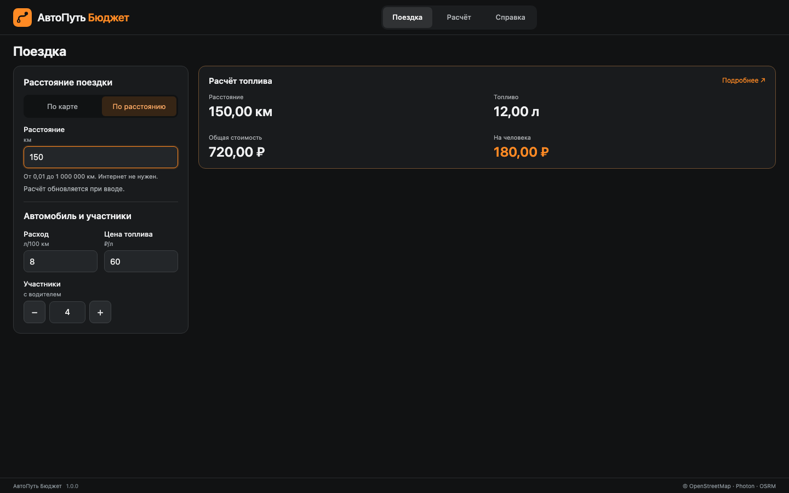

# АвтоПуть Бюджет

Приложение для расчёта топлива и стоимости поездки в браузере, Windows, macOS и Android. Расстояние можно получить по автомобильному маршруту или ввести вручную без интернета. Общая стоимость делится между участниками с учётом водителя.

Готовая MVP — **1.0.0**.

## Установка

Готовые приложения доступны в [выпуске 1.0.0](https://github.com/laytik491-cloud/autopath-budget/releases/tag/v1.0.0). Python и Node.js для их запуска не нужны.

| Система | Установщик |
|---|---|
| Windows 10/11 x64 | [EXE](https://github.com/laytik491-cloud/autopath-budget/releases/download/v1.0.0/AutoPath-Budget-1.0.0-win-x64.exe) |
| macOS 13+, Intel и Apple Silicon | [DMG](https://github.com/laytik491-cloud/autopath-budget/releases/download/v1.0.0/AutoPath-Budget-1.0.0-mac-universal.dmg) |
| Android 12+ | [APK](https://github.com/laytik491-cloud/autopath-budget/releases/download/v1.0.0/AutoPath-Budget-1.0.0-android.apk) |

[Инструкция установки](docs/installation.md) описывает запуск и подпись пакетов. APK из этого выпуска не устанавливается на Android 10. Исходники настольной и Android-оболочки находятся в [packaging](packaging/README.md).



## Возможности

- Выбор точек на карте, поиск адресов и ввод координат.
- Расчёт литров, общей стоимости и суммы на человека.
- Ручное расстояние и пересчёт параметров без сети.
- Автоматическое сохранение последнего корректного расчёта в браузере.
- Длинные маршруты с кнопкой «Весь маршрут» и сохранением масштаба при пересчёте.
- Компактный чёрно-оранжевый интерфейс для компьютера и телефона.

## Запуск из исходников

На компьютере нужен **Python 3.11 или новее**. Дополнительные Python-пакеты не требуются: библиотеки браузерной версии включены в `app/vendor`.

Откройте терминал в корне проекта и выполните:

```bash
python3 launch.py
```

В Windows:

```powershell
py -3 launch.py
```

Также можно открыть `Запустить Windows.bat` или `Запустить macOS.command`. Браузер откроется автоматически. Оставьте окно запуска работающим; для остановки нажмите Ctrl+C.

Если порт 8000 занят, программа выберет свободный и напечатает адрес. Начальный порт можно задать явно:

```bash
python3 launch.py --port 8001
```

Открывайте приложение через напечатанный HTTP-адрес. Двойной щелчок по `app/index.html` не заменяет локальный запуск.

## Использование

**По расстоянию:** выберите режим и введите километры. Литры и стоимость появятся сразу. При необходимости измените расход, цену и участников.

**По карте:** выберите А, затем Б и нажмите «Построить маршрут». Для поиска адреса используйте «Найти» и выберите результат. Координаты вводятся в порядке `широта, долгота`. Кнопка «Весь маршрут» возвращает полный путь после приближения.

| Параметр | Диапазон |
|---|---|
| Ручное расстояние | 0,01–1 000 000 км |
| Средний расход | 0,1–100 л/100 км |
| Цена топлива | 0,01–1000 ₽/л |
| Участники с водителем | Целое число от 1 до 9 |

Для десятичных значений подходят точка и запятая. Результат включает только топливо. Платные дороги, парковки, питание и проживание не учитываются.

## Работа без интернета

В установленных приложениях ручной расчёт доступен без сети с первого запуска: Python и ресурсы включены в пакет. Следующие сведения о первоначальном кэшировании относятся к браузерной версии.

Карта показывает страны, города, населённые пункты и улицы по масштабу. Для названий улиц приблизьте нужный участок. Для нового пути, поиска адресов и подложки нужен доступ к внешним сервисам. Приложение сообщает об ошибке самого запроса; отдельного индикатора «Есть сеть» нет.

При первой загрузке с интернетом локальные ресурсы автоматически сохраняются для автономного запуска. После загрузки и появления доступных полей можно проверить повторное открытие без сети и ввести новое ручное расстояние. При неполной загрузке или очистке кэша потребуется снова открыть приложение с интернетом. Установка значка сама по себе не подтверждает готовность кэша.

Полный автономный повторный запуск проверен в Chromium. В тестовом WebKit 26.5 пересчёт открытой вкладки без сети работает, но полный offline reload завершается внутренней ошибкой. Настоящие Safari и iOS требуют отдельной проверки.

## Репозиторий GitHub

Полный проект находится в [laytik491-cloud/autopath-budget](https://github.com/laytik491-cloud/autopath-budget). В корне находятся README, запуск браузерной версии, программа, SQLite, документация и тесты. Папка `packaging` содержит исходники Electron и Capacitor.

```bash
git clone https://github.com/laytik491-cloud/autopath-budget.git
cd autopath-budget
```

Готовые установщики и контрольные суммы размещаются в [Releases](https://github.com/laytik491-cloud/autopath-budget/releases/tag/v1.0.0). Файлы редакторов, зависимости сборки и ключи подписи исключены из репозитория. Библиотеки браузерной программы включены в `app/vendor`.

### GitHub Pages

В проект включён [workflow публикации](.github/workflows/pages.yml). Он запускается вручную и публикует содержимое `app` после успешного выполнения Python- и SQL-проверок.

1. Загрузите весь проект в основную ветку репозитория.
2. В GitHub откройте **Settings → Pages → Build and deployment → Source** и выберите **GitHub Actions**.
3. Откройте **Actions → Publish GitHub Pages → Run workflow** и выберите основную ветку.
4. Дождитесь успешного выполнения. Адрес появится в результате задания `deploy` и в **Settings → Pages**.
5. Откройте полученный HTTPS-адрес и дождитесь готовности автономного запуска.

При последующих обновлениях повторите ручной запуск workflow. В репозитории остаются исходники, документация и тесты; на сайт попадает только приложение. Внешний сервер расчётов и серверная БД не требуются.

Подробности: [официальная документация GitHub Pages](https://docs.github.com/en/pages/getting-started-with-github-pages/using-custom-workflows-with-github-pages). Само наличие workflow не означает, что сайт уже опубликован.

## Запуск на устройствах

| Устройство | Как открыть |
|---|---|
| Windows | `Запустить Windows.bat`, `py -3 launch.py` либо HTTPS-адрес опубликованного приложения |
| macOS | `Запустить macOS.command`, `python3 launch.py` либо HTTPS-адрес |
| Android | HTTPS-адрес в Chrome; значок добавляется через меню установки браузера |
| iPhone и iPad | HTTPS-адрес в Safari → «Поделиться» → «На экран Домой» → «Добавить» |

На телефоне Python не требуется. Адрес `127.0.0.1` означает само устройство и не ведёт к программе на другом компьютере. Для телефона используйте опубликованный HTTPS-адрес.

На компьютере опубликованное приложение можно установить средствами Chrome или Edge; в Safari на macOS 14+ доступно «Добавить в Dock». Пункты меню зависят от версии браузера. Официальные инструкции: [Chrome](https://support.google.com/chrome/answer/9658361?hl=ru), [iPhone](https://support.apple.com/ru-ru/guide/iphone/iphea86e5236/ios), [Safari на Mac](https://support.apple.com/ru-ru/104996).

## Структура репозитория

```text
.
├── .github/workflows/
│   ├── ci.yml                 Проверки Python и SQL при push и pull request
│   └── pages.yml              Ручная публикация app на GitHub Pages
├── app/
│   ├── index.html             Интерфейс
│   ├── main.mjs               Карта и взаимодействие с Python
│   ├── python/                Расчёт, контроллер, SQLite и внешние сервисы
│   ├── vendor/                Pyodide, Leaflet, значки и лицензии
│   └── sw.js                  Автономный кэш
├── database/                  Пустая SQLite и SQL-схема
├── docs/                      Пояснительная записка и описание реализации
├── packaging/                 Исходники установщиков Electron и Android
├── tests/                     Проверки и результаты
├── launch.py                  Локальный HTTP-сервер
└── README.md
```

## Проверки

Из корня проекта:

```bash
python3 -m unittest discover -s tests -v
```

В Windows можно использовать `py -3 -m unittest discover -s tests -v`. [GitHub Actions](.github/workflows/ci.yml) выполняет этот набор и `python database/verify_db.py` на Python 3.12 при `push` и `pull_request`.

Браузерные сценарии требуют Node.js и Playwright. Подготовка и команды находятся в [tests/README.md](tests/README.md). Фактические результаты и границы проверки — в [протоколе](docs/mvp/test-results.md).

## Хранение данных

Расчёт выполняется на Python в браузере через Pyodide. SQLite сохраняется единым образом в IndexedDB. Хранится один последний корректный расчёт. Ошибочный или незавершённый ввод не заменяет сохранённый вариант.

База схемы 2 поддерживает обновление корректных образов схемы 1. Файл [database/autopath.sqlite](database/autopath.sqlite) — пустая база поставки. Рабочие поездки браузера не записываются в этот файл автоматически. Порядок создания отдельного файла указан в [database/README.md](database/README.md).

Очистка данных браузера удаляет поездку. Другой адрес, порт, профиль или устройство использует отдельное хранилище. Синхронизация и одновременное редактирование в нескольких вкладках не реализованы. Линия пути не хранится в SQLite и после повторного открытия появляется при новом построении.

## Зависимости

- Python в браузере: Pyodide 314.0.7, Python 3.14.2.
- Карта: Leaflet 1.9.4.
- Адреса: Photon; автомобильный путь: OSRM; подложка: OpenStreetMap.

Для адресов и координат используются внешние сервисы. Цена, расход и участники остаются на устройстве. Доступность пути зависит от сервиса и данных карты.

Лицензии включённых библиотек: [Pyodide](app/vendor/pyodide/LICENSE), [Leaflet](app/vendor/leaflet/LICENSE). Внешние тайлы и ответы картографических сервисов не входят в автономный кэш.

## Документация

[Состав документации](docs/README.md).

[Пояснительная записка](<docs/ВПКС Самарин MVP 1.0.0.docx>) · [Описание реализации](docs/mvp/implemented-features.md) · [Ограничения](docs/mvp/known-limitations.md).

Автор учебного проекта — Самарин Никита Андреевич.
